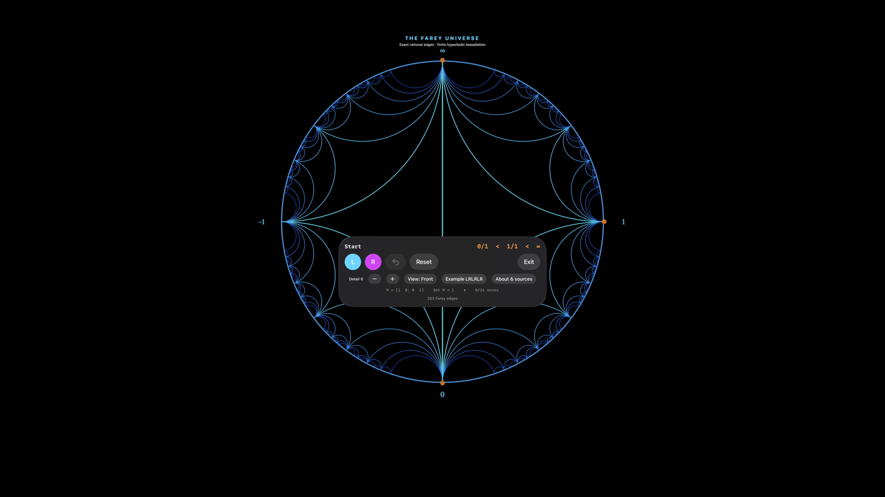

# Farey — Into the Infinite

**Inspired by [Katherine Stange’s mathematical visualizations](https://www.katestange.net/code/) and her [Illustrating Mathematics for Math 2.0 talk](https://katestange.net/talks/math-exploration/).** Underlying L/R geodesic coding: [Caroline Series (1985)](https://doi.org/10.1112/jlms/s2-31.1.69).

A native, stationary, fully immersive visionOS mathematics demo. The focal object is a finite Farey tessellation in the Poincaré disk, surrounded by a black void. `L` and `R` multiply an exact integer matrix, narrow a rational interval, and light the visited geodesics. Undo, Reset, Exit, bounded detail and three static viewpoints are always available.

[Watch the simulator tour](evidence/demo.mp4) · [Test results and screenshots](evidence/README.md)



## Run on this Mac

Xcode 27.2 beta 2 and visionOS 27.2 are installed. In Xcode 27, the simulator UI is **Device Hub**, not a separate Simulator app.

```sh
cd /Users/alokbeniwal/Documents/Codex/2026-10-21/task-7/FareyVision/Farey
export PATH=/usr/bin:/bin:/usr/sbin:/sbin:/opt/homebrew/bin
/opt/homebrew/bin/xcodegen generate --spec project.yml
xcodebuild -project FareyVision.xcodeproj -scheme FareyVision \
  -destination 'platform=visionOS Simulator,id=D2ECE520-ED92-4A38-A990-AE65431DF562' \
  -configuration Release -derivedDataPath .derivedData-native -jobs 3 CODE_SIGNING_ALLOWED=NO build
xcrun simctl boot D2ECE520-ED92-4A38-A990-AE65431DF562 # if shut down
xcrun simctl bootstatus D2ECE520-ED92-4A38-A990-AE65431DF562 -b
xcrun simctl install D2ECE520-ED92-4A38-A990-AE65431DF562 .derivedData-native/Build/Products/Release-xrsimulator/FareyVision.app
xcrun simctl launch D2ECE520-ED92-4A38-A990-AE65431DF562 com.alok.FareyVision
open /Applications/Xcode-27.2.0-Beta.2.app/Contents/Applications/DeviceHub.app
```

Or run `./scripts/run-simulator.sh`.

Select **Apple Vision Pro — Simulator** in Device Hub. Click **Capture Pointer** at the bottom right, then click **Enter the void**. `L`, `R` and **Example LRLRLR** highlight the itinerary. **Reset** restores the initial interval, detail and front view. **Exit** returns to the launch window. There is no automatic camera motion.

## Mathematics and attribution

The inspiration is [Katherine Stange's *Illustrating Mathematics for Math 2.0* talk](https://katestange.net/talks/math-exploration/), particularly the Farey tessellation, mediant construction, L/R continued-fraction demonstration and lattice interpretation. See her [visualization catalog](https://www.katestange.net/code/). The underlying symbolic coding is credited to Caroline Series, [*The modular surface and continued fractions* (1985), DOI 10.1112/jlms/s2-31.1.69](https://doi.org/10.1112/jlms/s2-31.1.69).

All new Swift mathematics and renderer code is original. No source code, screenshots, media or assets from Stange's website are bundled, and no license for her exact demo is presumed. This is an independent implementation, not an official port or endorsement.

`M` starts at the identity, with columns `right=(a,c)` and `left=(b,d)`. The interval is `b/d < (a+b)/(c+d) < a/c`, with infinity allowed. The app uses Stange's convention:

```
L = [1 1; 0 1]    R = [1 0; 1 1]
M ← M L          M ← M R
```

Thus **L replaces the left column by the mediant**, and **R replaces the right column**. These are matrix labels, not instructions to move the camera left or right. Every step preserves `ad − bc = 1`. The displayed center fraction is `M(1)`, while the two interval endpoints are `M(0)` and `M(∞)`. The chronological right-multiplied word is kept exactly; it is not presented as an infinite irrational continued fraction.

A rational `p/q` is placed at `(2pq/(p²+q²), (p²−q²)/(p²+q²))` on the unit circle. Neighboring rationals are joined by circular arcs orthogonal to the boundary (or a diameter). Two reflected Stern–Brocot trees cover the disk. Rational combinatorics are exact; the circular arcs are finite sampled tube meshes. The tube thickness, color, physical placement and viewpoint are presentation choices. The image is a **finite tessellation**, not the entire infinite tessellation or a reconstructed Stange fractal.

## Budget and verification

The app caps navigation at 24 moves and detail at 7, giving 509 background edges. Each arc has 32 segments and a six-sided tube; geometry is batched by depth. Geometry changes only on input; no per-frame regeneration or forced motion occurs. The exact core can be tested independently:

```sh
swift test --package-path Packages/FareyCore --scratch-path .build-core
xcodebuild -project FareyVision.xcodeproj -scheme FareyVision \
  -destination 'platform=visionOS Simulator,id=D2ECE520-ED92-4A38-A990-AE65431DF562' \
  -derivedDataPath .derivedData-native -parallel-testing-enabled NO -jobs 3 \
  CODE_SIGNING_ALLOWED=NO test
```

For optimized simulator tests, add `-configuration Release ENABLE_TESTABILITY=YES ONLY_ACTIVE_ARCH=YES`; testability is needed by the model test's `@testable` import. The ordinary Release build does not require it.

The parent repository is reused for its working native visionOS/XcodeGen conventions. Existing Hévéa source and research files are unchanged. This target is separately named and bundled. New code follows the repository's GPL-3.0-or-later license.

The controls use a pushed native window, so the entry window is retained in the background and returns on Exit. This avoids tearing down the last regular scene. The mathematical scene is fixed in world space; changing the view rotates the object without moving the simulated viewer.

See [simulator evidence](evidence/README.md) for checks and captures. To record a new test tour, run `python3 scripts/capture-tests.py`; the script records only the simulator screen. Raw recordings and result bundles are local artifacts, not committed media.

Hardware installation, comfort and performance must be verified separately; simulator results do not establish those claims.

## Existing hardware signing

The device target uses development team `5795ZPYZ2T` and the already-installed wildcard profile **Lean Calculator Vision Pro 20261008** (expires 2027-10-08). Its certificate matches the installed development identity, its wildcard covers `com.alok.FareyVision`, and it includes the paired Vision Pro. No new certificate, app identifier or provisioning profile was created. These device-only settings do not change the unsigned simulator workflow.

A signed Release build and strict signature verification succeeded on 2026-10-21. Use a local temporary build directory to avoid Finder metadata being attached to generated app bundles in the synced Documents workspace:

```sh
xcodebuild -project FareyVision.xcodeproj -scheme FareyVision \
  -configuration Release -destination 'generic/platform=visionOS' \
  -derivedDataPath /tmp/FareyVision-device -jobs 3 build
codesign --verify --deep --strict /tmp/FareyVision-device/Build/Products/Release-xros/FareyVision.app
```

The paired headset reports visionOS 27.2 and Developer Mode enabled, but the read-only connection check returned **CoreDevice error 10003 / RemotePairing error 1016: device locked, not unlocked recently**. Unlock the headset before installing. No installation or hardware execution has been performed. After unlocking, obtain its identifier with `xcrun devicectl list devices`, then run:

```sh
xcrun devicectl device install app --device YOUR_VISION_PRO_IDENTIFIER \
  /tmp/FareyVision-device/Build/Products/Release-xros/FareyVision.app
```
