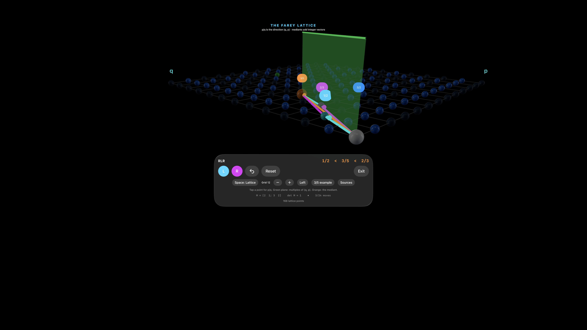

# Native 0.6 / browser 0.5: a separate approximant spotlight

[Native spotlight](spotlight/native-spotlight.png) · [Linked disk](spotlight/native-disk.png) · [Outside-grid case](spotlight/native-outside-grid.png) · [Browser](spotlight/browser-spotlight.png) · [Phone context](spotlight/phone-spotlight.png) · [Validation](spotlight/validation.json) · [Full native results](spotlight/simulator-summary.json) · [Final fresh walkthrough](spotlight/fresh-walkthrough-summary.json) · [Current showcase](spotlight/showcase.png)

An approximant row controls a separate spotlight. Double white rings locate it; the target rational, inspected integer point and lesson prediction are unchanged. The spotlight survives view changes and reclassification when its row remains, and clears on target changes, Reset, or removal of the row. Points outside the finite grid retain their coordinates and receive an explicit message. A boundary row such as 0/1 can be spotlighted without becoming the positive target.

Fresh-start walkthroughs cover the lesson, reducible input, convergent/intermediate rows, expansion changes, target changes, Undo/Reset, out-of-grid handling and responsive layouts. The review exposed two visibility problems: native row selection could leave its marker behind the popover, and phone scrolling could hide the spotlight's context. Native selection now dismisses the picker; the browser keeps target and spotlight context together and scrolls the row list independently. These are UI changes, not camera moves.

The browser source and static artifact passed the [fresh walkthrough](spotlight/browser-static.json), alongside existing CF, point, keyboard/lesson and graphics-recovery regressions. An instrumented local copy checked [200 spotlight changes](spotlight/browser-resources.json): geometry count peaked at 17 from a 16-geometry baseline and returned to 16 after clearing; textures stayed at 2 and programs at 6. The camera pose was unchanged. This is a controlled resource check, not a headset/FPS measurement.

Twenty core tests, sixteen native model/UI regression tests, and twenty-two JavaScript tests passed. Final presentation changes passed the complete fresh native walkthrough again. The native fresh walkthrough is recorded with separate full-suite and final focused results. Physical headset execution and genuine WebXR sessions remain unverified; tracking consent and public deployment remain pending. No new signing assets or permissions were added.

# Native 0.5 / browser 0.4: convergents and intermediate mediants

[Native canonical form](convergents/native-canonical.png) · [Native alternate form](convergents/native-alternate.png) · [Linked disk](convergents/native-disk.png) · [Browser canonical form](convergents/browser-canonical.png) · [Browser alternate form](convergents/browser-alternate.png) · [Validation](convergents/validation.json) · [Simulator results](convergents/simulator-summary.json) · [Current showcase](convergents/showcase.png)

Convergents are truncations of the chosen finite simple continued fraction. The default canonical form ends in at least 2, except for an integer. Replacing the final term `a` by `a−1, 1` preserves the rational but can change its convergent list. For `3/5`, the visited `2/3` is intermediate under `[0;1,1,2]` and a convergent under `[0;1,1,1,1]`. Gold rings mark convergents and gray rings mark other visited L/R mediants. The `0/1` boundary is listed when it is a convergent; it remains non-selectable. Neither representation identifies lattice distances with hyperbolic distances.

The [cross-platform comparison](convergents/parity.json) agrees on coefficients, convergents and classifications for both expansions of 881 accepted numerator/denominator pairs: 1,762 comparisons. Integer, unit-fraction, improper-fraction, reducible-input and finite endpoint cases are covered. These are bounded tests, not a formal proof. Stange's endpoint convention uses an even-length expansion ending in an R block; the app still displays M(1), and appending R sends M(∞) to the same rational.

[Browser source](convergents/browser-source.json) and [built artifact](convergents/browser-static.json) checks verified the `2/3` label change and actual changes in an unobscured 3D image region without changing `RLR` or the inspected point. Existing [keyboard/lesson](convergents/browser-regression.json), [point identity](convergents/point-regression.json), and [real context-loss recovery](convergents/graphics-recovery.json) checks passed. A separate instrumented local copy exposed renderer counters for [200 programmatic moves and expansion toggles](convergents/browser-resources.json): counts remained at 16 geometries, 2 textures and 6 programs. This is not an FPS or headset-performance claim.

Seventeen Swift core tests, fourteen native model/UI tests, and twenty-one JavaScript tests passed. Signed device and clean simulator builds passed with the existing signing assets. Native 0.5 is installed on the original showcase simulator at 3/5 in the Left view.

Definitions and recurrence were checked against [DLMF §1.12(ii)](https://dlmf.nist.gov/1.12.ii); endpoint context comes from [Stange's viewer](https://katestange.net/talks/math-exploration/viewers/farey-cf-lattice.html). New implementation code is original. Physical headset execution and an actual WebXR session remain unverified, and no pending permission was granted.

# Native 0.4 / browser 0.3: points and primitive directions

[Native inspector](point-inspection/native-multiple.png) · [Linked disk](point-inspection/native-disk.png) · [Browser inspector](point-inspection/browser-multiple.png) · [Simulator results](point-inspection/simulator-summary.json) · [Cross-platform comparison](point-inspection/parity.json) · [Validation](point-inspection/validation.json) · [Current showcase](point-inspection/showcase.png)

The selected integer point remains distinct from its reduced direction: `(10,6) = 2 × (5,3)` represents `6/10 = 3/5`, with exact L/R word `RLR`. Both apps explain the gcd and primitive vector. The native disk retains the same point inspection while showing the reduced rational's boundary point and green geodesic. The finite upright plane now extends to the grid boundary. White marks a non-primitive inspected point and orange marks the primitive mediant. Grid changes never move the inspected coordinates to the edge.

Fourteen Swift core tests, twelve native model/UI tests and nineteen JavaScript tests passed. The [966-case comparison](point-inspection/parity.json) checks acceptance, point factorization, primitive direction and exact word, including zero, negative and bounded inputs. A further [focused UI check](point-inspection/focused-summary.json) passed with the final screenshot. Native UI tests selected the spatial 6/10 label, inspected its reduction, switched to the disk, exited/re-entered, reduced the grid, then used Undo and Reset. The actual sphere/raycast path was tested with a mouse in both the [browser source](point-inspection/browser-source.json) and [static artifact](point-inspection/browser-static.json); point identity also survived reload. The existing keyboard, lesson and layout [regression](point-inspection/browser-regression.json) and three browser-generated WebGL loss/restoration cycles passed again.

A signed native Release build and clean Debug simulator build passed using the existing signing assets. Physical headset execution and genuine WebXR sessions remain unverified; no tracking permission or new signing asset was granted. [Reference conventions](point-inspection/reference-check.json) were rechecked against Stange's public viewer; no source or media was copied.

# Native 0.3: direct fraction entry

[Reduced 6/10 entry](native-03/fraction-entry.png) · [13/17 beyond the finite grid](native-03/outside-grid.png) · [Full simulator summary](native-03/simulator-summary.json) · [Focused UI recheck](native-03/direct-entry-summary.json) · [Validation](native-03/validation.json)

The p/q control opens a native entry popover. It accepts positive numerator and denominator values up to 1000 before reduction, provided the exact L/R path has at most 24 moves. It reports zero denominators, non-positive values, malformed text, integer overflow, raw bounds and excessive path length without changing the current mathematical or lesson state. Valid entry replaces the path, clears a stale lesson, and preserves the active lattice/disk representation. Undo removes the final move on that path.

Ten Swift core tests and ten native model/UI tests passed. A final focused UI run also passed after strengthening the Undo assertion. Simulator tests typed valid, overflow, zero-denominator, out-of-range and long-path entries; checked the linked disk/lattice; and verified the selected fraction survived exit/re-entry. A comparison of [907 inputs](native-03/browser-parity.json) found no difference between native entry and browser selection in acceptance, reduced rational or exact word. This is bounded test evidence, not a formal proof.

A clean Debug simulator build and a Release device build passed. The Release signature verified against the existing signing assets; no new profile, certificate or grant was created. No physical headset installation or execution is claimed.

# Browser 0.2.3: context-loss and reload recovery

[Before the fix](webxr/context-before-fix.png) · [Visible paused state](webxr/context-paused.png) · [Automatically restored geometry](webxr/context-restored.png) · [Validation record](webxr/recovery-023-validation.json)

The previous build stayed blank after the browser restored a lost WebGL context, until another interaction forced a render. It also discarded the current rational and grid on reload. The revised app repaints on restoration, keeps L/R usable while graphics are paused, and restores the exact L/R word and grid from validated per-tab storage. Reload resets the camera and closes the lesson; Reset explicitly replaces the saved state.

Source and static artifacts each passed three loss/restoration cycles using the actual `WEBGL_lose_context` extension. The browser-generated events were trusted, and the unchanged 3D region matched pixel-for-pixel after restoration. The reload button preserved 5/8 and grid 14 after an L move during loss. The ordinary static-artifact workflow passed afterward. Sixteen JavaScript tests passed, including corrupt/unavailable storage and bounds checks. Initial WebGL-creation failure was tested separately with an explicit mock: it showed an error, disabled unusable controls and retained reference links.

This is controlled browser-context recovery evidence, not physical GPU-failure, hardware or XR-session recovery. Native 0.2 remains unchanged.

# Browser 0.2.2: gesture separation and accessible controls

[Landscape scene](webxr/landscape-022.png) · [Actual Safari landscape](webxr/safari-landscape.png) · [Safari after a drag](webxr/safari-landscape-drag.png)

Thirteen JavaScript tests passed, including five regressions for single taps, multiple pointers, drags returning to their start, cancelled gestures and secondary mouse buttons. The [integration record](webxr/input-022-validation.json) separates Chromium protocol-generated touch gestures from physical input. Those tests verified pinch zoom, two-finger pan, one-finger orbit, single-tap selection, keyboard pan/rotate/zoom/Home, and that typing in the fraction field does not move the camera. Source and built-artifact lesson/bounds workflows passed. Renderer counts remained at 14 geometries, 2 textures and 6 programs after 200 further moves.

A [real landscape Safari drag on the iPhone simulator](webxr/safari-landscape-validation.json) changed the camera without changing the selected fraction. The lattice and controls occupy separate landscape regions. No physical phone or headset was used.

The rendered accessibility tree exposes the canvas as a named image with the selected rational and vector description, and gives L/R their endpoint-action descriptions. Keyboard focus and semantic structure were tested; **screen-reader speech was not tested**. No OS accessibility setting or XR permission was changed. The public guide continues to distinguish implementation, simulator evidence, synthetic touch events, actual XR sessions and mathematical proof.

# Browser 0.2.1: usable mobile lesson and reliable refresh

Actual iPhone 17e simulator Safari on iOS 27.2 completed [L](webxr/mobile-safari-L.png), [R](webxr/mobile-safari-R.png), Undo and [Reset](webxr/mobile-safari-reset.png). The [record](webxr/mobile-safari-validation.json) contains the selected states after real Device Hub taps. The lattice remains visible above the lesson controls. This is a mobile browser simulator test, not a physical phone or WebXR headset test.

The [automated browser walkthrough](webxr/browser-021-validation.json) passed against source and built output: keyboard focus through both lesson moves and Close, visible phone scene, reset/undo, 24-move cap and recovery, grid limits, reducible fraction selection and rejection of an unreachable fraction. Content-hashed app/CSS URLs matched their manifest. Eight JavaScript tests passed. A projected click on the relocated canvas selected 3/2, verifying the updated pointer coordinates.

[Renderer resource counts](webxr/resource-stability.json) stayed at 14 geometries, 2 textures and 6 programs across four rounds of 50 moves with grid changes and resets. This measures renderer object stability, not frame rate, total memory or hardware performance. The temporary inspection wrapper is not shipped. Native 0.2 remains unchanged and available in the original simulator.

# Version 0.2: worked path and browser readiness

[Current native 3/5 scene](spatial/showcase-02.png) · [Native L explanation](spatial/lesson-L.png) · [Native R explanation](spatial/lesson-R.png) · [Desktop Safari lesson](webxr/desktop-safari-lesson.png) · [Portrait browser](webxr/portrait.png)

The native lesson predicts and applies the ordinary L/R operations at 1/2, 2/3 and 3/5. Its exact vector explanation, selected fraction, lattice and disk share the same state. [Eight native tests passed](spatial/native-02-summary.json): three model tests and five UI tests. After changing the lesson presentation from a sheet to a fully visible popover, [the focused lesson UI test passed again](spatial/lesson-popover-summary.json). Version 0.2 Debug simulator and signed Release device builds succeeded, and strict signature verification passed. The Debug 0.2 app was installed and launched in the original simulator at the 3/5 Left view. Physical-headset execution remains untested.

[Desktop Safari 27.0.1](webxr/desktop-safari.json) completed the lesson with a clean page console. Portrait Chromium was inspected at 390 × 844. The eight JavaScript tests passed. The final 0.2 [static artifact](webxr/static-02-validation.json) completed the same lesson using its local vendored modules, with no page errors; see [the resulting scene](webxr/static-02-lesson.png) and [portrait Front view](webxr/portrait-front.png). A [mocked pending-request test](webxr/pending-recovery.json) verified duplicate-entry prevention and desktop recovery; it is explicitly not XR runtime evidence.

[The current Safari XR probe](webxr/safari-probe.json) advanced past the initial UI-accessibility problem: a real click reached Safari’s permission prompt for device position and head-movement tracking. No permission was granted, no session started, and no XR frames were observed. The probe ran only on an isolated simulator; the native app remained available. No security settings or grants were changed.

# Earlier spatial and browser evidence

**2026-10-22 spatial revision:** [39-second simulator excerpt](spatial/demo.mp4), [3/5 showcase](spatial/showcase.png), [opposite translated view](spatial/right-view.png), [linked disk](spatial/linked-disk.png), [attribution panel](spatial/sources.png).

- Seven Swift core tests passed, including all visible rational selections, exact ray incidence, the 24-move cap and orthogonal circular geodesics.
- Six native Debug tests passed, zero failures or skips: two model tests and four UI tests. [Final Xcode summary](spatial/simulator-summary.json). The UI tests cover L/R, Undo, Reset, grid limits, the move limit and recovery, linked lattice/disk selection, and four consecutive entry/exit cycles.
- Fresh Debug build from the checked-in XcodeGen specification passed. The latest Release device build and strict signature verification also passed using the existing signing material. No physical-headset installation or execution occurred.
- Strict SwiftLint passed with zero violations. Geometry is capped at 224 lattice points / 196 positive selectable pairs, and 509 disk edges. Static geometry is cached; updates do not run per frame. No new frame-rate measurement is claimed.
- Front/Left/Right change the model placement relative to a stationary viewer. These spatial-revision captures demonstrate the resulting parallax; they are not evidence of physical-headset tracking or a new independent Device Hub camera-navigation run.

The video is a real simulator-screen excerpt from the passing run, with entry/exit transitions. No desktop, private recording or Stange media is included. Some automatic screenshot requests lagged the test markers; only visually checked captures are published above, with captions based on their visible state. Raw recordings, uncurated captures and result bundles remain local.

**Browser companion:** [3/5 scene](webxr/farey-webxr-final.png), [mouse orbit](webxr/farey-webxr-orbit.png), [sphere selection](webxr/farey-webxr-point-selected.png), [validation record](webxr/validation.json). Eight JavaScript tests passed, including unsupported/error paths, transient input poses and camera restoration. Real browser interactions verified the 24-step limit, Undo recovery, invalid-input rejection, grid cap, 6/10 → 3/5 selection and a mouse click selecting (q,p)=(3,2). Chromium's console was clean after the final change. It reported immersive VR unsupported, so no actual WebXR headset session was tested.

[Launch instructions](../README.md#run-on-this-mac) · [Browser instructions](../WebXR/README.md) · [Guest-post evidence guide](../GUEST_POST_EVIDENCE.md)

---

# Archived disk-only simulator evidence

[Watch the 32-second simulator tour](demo.mp4). [Launch instructions](../README.md#run-on-this-mac).

Environment: Xcode 27.2 beta 2 (27B5028f), visionOS simulator 27.2 (24N5093f), Apple Vision Pro `D2ECE520-ED92-4A38-A990-AE65431DF562`. The room visible before entry is the simulator's synthetic environment. The captures contain no desktop or private recording.

## Verified results

- **Exact core: 5 passed.** All 8,191 L/R words through length 12 preserve determinant 1 and reduced mediants. Tests cover the 24-move cap, undo/reset, tessellation counts and disk bounds through depth 8, and a known orthogonal circular geodesic.
- **Native simulator: 4 passed, 0 failures** in `Simulator-20261021T232015Z.xcresult`, completed 2026-10-21 23:22:27 UTC. [Exported Xcode result summary](simulator-summary.json). This is one model test and three UI tests, with seven immersive sessions in the same running app, including four consecutive enter/L/reset/exit cycles.
- The UI tests assert attribution, exact `LR → 3/2`, Undo, the example word, all three object views, minimum/maximum detail, disabled controls at 24 moves, recovery after Undo, repeated Reset, and repeated exit/re-entry.
- **Release build: succeeded.** The optimized app was installed and launched on the simulator. Strict SwiftLint passed with zero violations; staged whitespace checks passed.
- **Optimized simulator suite: 4 passed, 0 failures**, completed 2026-10-21 23:30:28 UTC. [Release result summary](release-summary.json). Run with `-configuration Release ENABLE_TESTABILITY=YES ONLY_ACTIVE_ARCH=YES` for the model test's internal-module access.
- [Measured rendering updates](performance-samples.json): two 509-edge rebuilds took 12.62–13.01 ms; 36 updates at the 253-edge default had a median of 1.76 ms and a maximum of 19.39 ms. These are synchronous CPU-side update timings from this simulator run, not frame-rate or headset measurements.

| Capture | Verified state |
|---|---|
| [Entry](00-entry.png) | Prominent Katherine Stange credit, original links, Series link |
| [Sources](00-sources.png) | Full attribution and precise original/finite implementation description |
| [Initial void](01-initial-void.png) | Stationary, full black immersion, 253-edge default |
| [L then R](02-LR-selection.png) | Selected itinerary and exact mediant 3/2 |
| [Oblique](03-oblique.png), [side](04-side.png) | Static object rotations without forced camera motion |
| [Maximum detail](05-maximum-detail.png) | 509-edge rendering cap |
| [Reset](06-reset.png), [re-entry](07-reentered.png) | Initial state restored and geometry recreated |
| [24-move limit](08-move-limit.png) | Full fraction remains legible, determinant 1, L/R disabled |
| [Viewer left](10-viewer-left.png), [viewer right](11-viewer-right.png), [closer](12-viewer-near.png) | Independent camera translation, intact world-space geometry and readable controls |

[Frame manifest](frame-manifest.json) records timestamps in the raw simulator recording. The final passing suite occurred within a continuous simulator-only recording that was finalized after a simulator restart. The curated clip and PNGs are from that suite, not reconstructed mockups. Raw movies, logs and `.xcresult` bundles remain local and are excluded from Git. Reproduce using `scripts/test-simulator.sh` or `scripts/capture-tests.py`.

## Fixes found through simulation

An initial SwiftUI container identifier overrode its child button identifiers; it was removed. Directly dismissing/reopening the last regular window caused a second-exit failure. The app now follows Apple's [associated-window pattern](https://developer.apple.com/documentation/visionos/associating-a-window-with-an-immersive-space): a pushed controls window retains the entry window in the background, and the active scenes close together. Each immersive session has fresh scene identity, and rendering waits for the open operation to complete.

XCTest's `XCUIScreen.screenshot()` reports “Manual screenshots are not supported” on this runtime. Evidence uses `simctl io recordVideo` and `simctl io screenshot`. The recording helper now checks that recording actually starts and that a finalized file exists; it does not report a busy recorder as a saved video.

## Scope of validation

The simulator exercised front, oblique and side **object views**, plus independent left/right/forward camera translation using Device Hub's documented A/D/W controls. Reset Camera restored the default. A temporary local XCTest harness held the immersive scene open during this inspection, then reset and exited; it is not part of the shipped test suite. Device Hub's coordinate-input bridge intermittently returned `noWindowsAvailable`; keyboard navigation and native XCTest interactions supplied working alternatives.

No physical-headset execution, hand/eye gesture, comfort, frame-rate or battery claim is made. A signed device-target Release build and strict signature verification passed using the existing wildcard profile and installed development certificate; see [hardware signing](../README.md#existing-hardware-signing). The headset is paired and Developer Mode is enabled, but read-only access was blocked because it is locked (CoreDevice 10003 / RemotePairing 1016). No hardware deployment was attempted. Geometry is capped at 509 background edges in the app, sampled with 32 segments and six-sided tubes, and grouped into at most 13 geometry model entities. No per-frame geometry generation runs.

## Initial Safari WebXR probe (superseded)

[Initial probe record](webxr/safari-probe-initial.json): an isolated visionOS 27.2 Safari reported secure context, WebXR exposed, and immersive VR supported. The actual entry action was blocked by Safari’s first-run welcome and XCTest `kAXErrorAPIDisabled`. No session, stereo frame, or XR interaction was observed. No permissions or security settings were changed. The temporary simulator was shut down and removed; the native showcase remained on its original simulator.

## Worked browser path and static build

[Apply L](webxr/farey-lesson-L.png) and [apply R](webxr/farey-lesson-R.png) show a real browser walkthrough, with [recorded assertions](webxr/lesson-validation.json). A wrong prediction still permits applying the exact move and reading its result. The same state drives the lattice, matrix, selected fraction and vector explanation. Undo or manual state changes close a stale lesson. Reset was verified. No educational efficacy or Lean backing is claimed.

The [static build validation](webxr/static-validation.json) records a locally tested deployment artifact and file hashes. The build loaded using only local assets and its console was clean. [Unsupported-VR fallback](webxr/farey-static-fallback.png) remains usable. See the [deployment plan](../WebXR/DEPLOYMENT_PLAN.md); no site was published.
